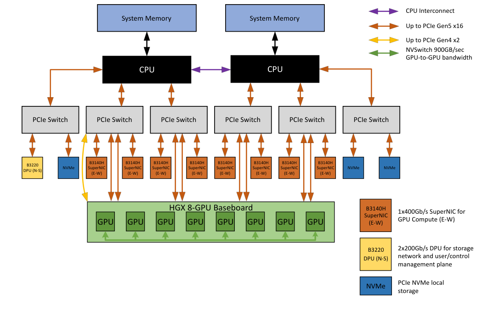
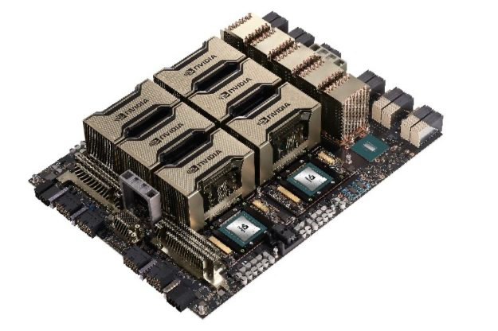
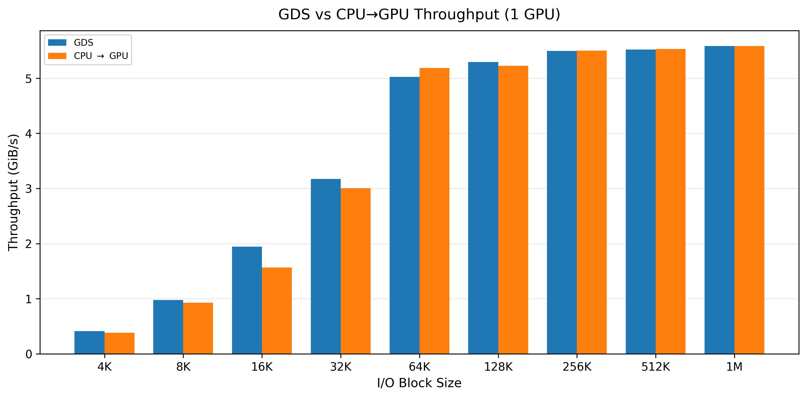
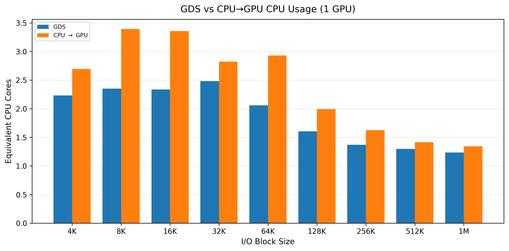
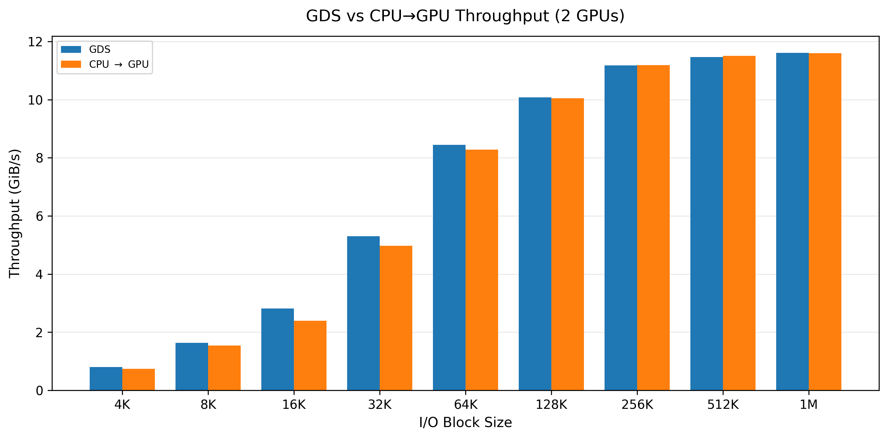
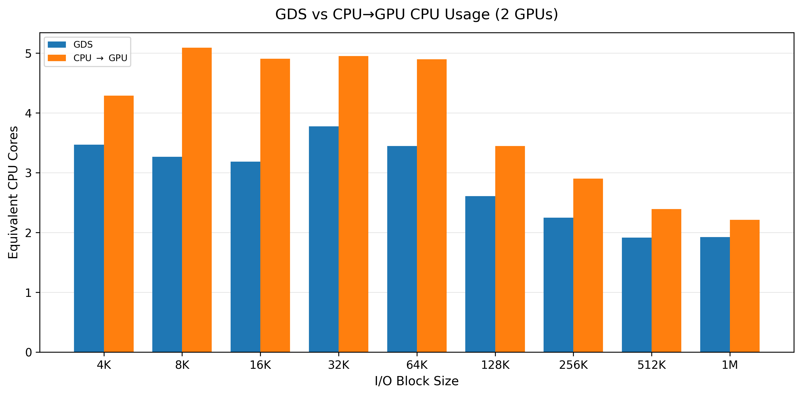
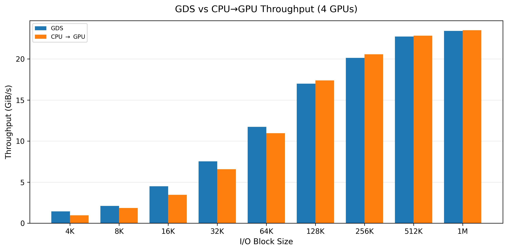
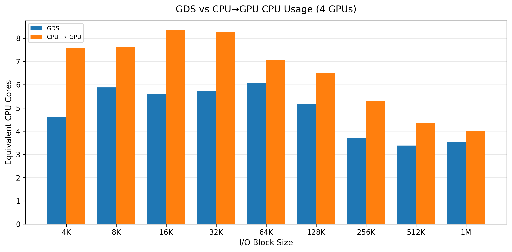
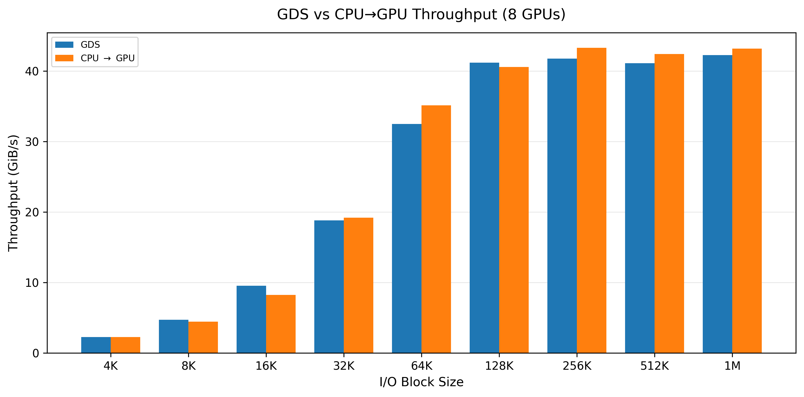
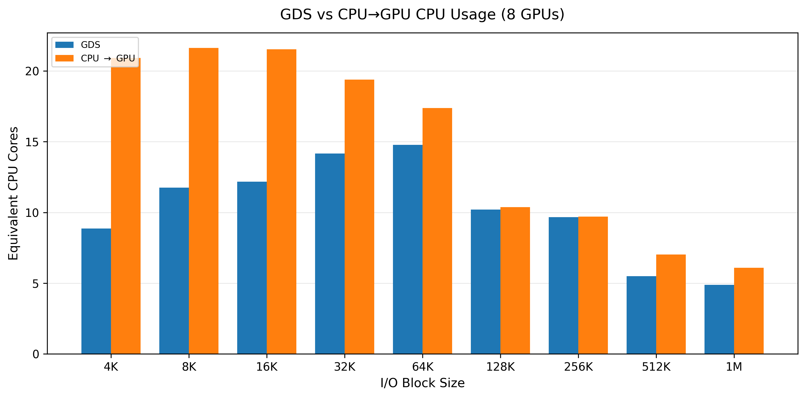

# NVIDIA H200 Hardware Benchmark Report

## 1. Objectives

Evaluate the hardware performance of an **8 × NVIDIA H200 SXM 141 GB** system on the HGX platform, focusing on three main areas:

- GPU compute performance: FP32, TF32, BF16, FP16, and FP8.
- HBM3e memory bandwidth.
- PCIe bandwidth between the CPU and GPUs.

The report covers two levels of measurement:

- **Single-GPU baseline:** detailed measurements on GPU0. For compute, kernels/configurations are searched using the exact benchmark shape before sustained runs, avoiding reliance on a manually selected kernel.
- **Multi-GPU validation:** tuned BF16, HBM reads, and PCIe H2D/D2H tests assess consistency and sustained performance when all 8 GPUs operate concurrently.

These results serve as a **hardware baseline** before evaluating NCCL/NVLink/NVSwitch, GPUDirect RDMA, GPUDirect Storage, distributed training, or inference.

---

# 2. Internal Topology of the HGX H200 System

### NVIDIA Reference Architecture



*NVIDIA’s example HGX H100/H200/B200 8-GPU system architecture. PCIe connects the CPUs, GPUs, network adapters, and storage; the GPU baseboard provides the NVLink/NVSwitch interconnect. Source: [NVIDIA HGX AI Factory — Components, Figure 3](https://docs.nvidia.com/enterprise-reference-architectures/hgx-ai-factory-h100-h200-b200/latest/components.html).*

This is a reference design. It shows BlueField-3 SuperNICs and a DPU; the benchmark node uses the ConnectX-7 adapters and GPU-local NVMe layout documented in Section 2.3. Use that section for the measured node’s device mapping.



*Physical view of the HGX H100/H200 8-GPU baseboard. Source: [NVIDIA HGX AI Factory — Components, Figure 1](https://docs.nvidia.com/enterprise-reference-architectures/hgx-ai-factory-h100-h200-b200/latest/components.html). Images are stored locally; original download links are recorded in [the image source notes](assets/architecture/SOURCES.md).*

## 2.1. Main Components

The current system consists of:

- **8 × NVIDIA H200 SXM 141 GB**.
- **2 × Intel Xeon Platinum 8558**, with 192 logical CPUs in total.
- **4 NUMA nodes**.
- **4 × third-generation NVSwitches** on the HGX H200 baseboard.
- Each H200 has **18 × fourth-generation NVLinks**.
- Each NVLink provides **50 GB/s of bidirectional bandwidth**, giving each GPU a total NVLink bandwidth of:

  ```text
  18 × 50 GB/s = 900 GB/s bidirectional
  ```

- For 8 GPUs, NVIDIA specifies **7.2 TB/s** of aggregate NVLink bandwidth for the HGX H100/H200 8-GPU baseboard.
- Each GPU also has a local PCIe branch containing:
  - 1 × H200 GPU;
  - 1 × NVIDIA/Mellanox ConnectX-7;
  - 1 × local Samsung NVMe drive.
- The 8 GPU-local 3.5 TB NVMe drives are currently combined into a RAID5 array at `/dev/md1`.
- Two ~894 GB NVMe drives (`nvme5n1`, `nvme6n1`) serve the operating system through RAID1 and are separate from the GPU-local NVMe group.

NVLink/NVSwitch topology sources:

- NVIDIA Fabric Manager User Guide: https://docs.nvidia.com/hgx-platforms/fabric-manager-user-guide/index.html
- NVIDIA NVLink specification: https://www.nvidia.com/en-us/data-center/nvlink/
- NVIDIA HGX H100/H200 reference architecture: https://docs.nvidia.com/enterprise-reference-architectures/hgx-ai-factory-h100-h200-b200/latest/components.html

Commands used to inspect the topology on the node:

```bash
nvidia-smi topo -m
lspci -tv
numactl --hardware
lsblk -o NAME,MODEL,SIZE,TYPE,MOUNTPOINT
```

## 2.2. How Each GPU’s 18 NVLinks Connect to 4 NVSwitches

HGX H200 uses the same NVLink/NVSwitch topology as HGX H100. GPUs are not connected pairwise through dedicated cable groups; **each GPU connects to all 4 NVSwitches**, which route traffic between GPUs.

Each GPU distributes its 18 NVLinks as follows:

```text
                    H200 GPU
                       |
          +------------+------------+------------+
          |            |            |            |
       4 links      5 links      5 links      4 links
          |            |            |            |
      NVSwitch 1   NVSwitch 2   NVSwitch 3   NVSwitch 4

                     Total = 18 NVLinks/GPU
```

For 8 GPUs:

```text
8 GPU × 18 NVLinks/GPU = 144 GPU↔NVSwitch links
```

According to NVIDIA’s official topology:

- NVSwitch 1 receives 4 links from each GPU → **32 GPU-facing links**.
- NVSwitch 2 receives 5 links from each GPU → **40 GPU-facing links**.
- NVSwitch 3 receives 5 links from each GPU → **40 GPU-facing links**.
- NVSwitch 4 receives 4 links from each GPU → **32 GPU-facing links**.

Total:

```text
32 + 40 + 40 + 32 = 144 GPU↔NVSwitch links
```

The logical path between two GPUs is:

```text
GPU A
  |
  | NVLink 4
  v
NVSwitch fabric
  |
  | NVLink 4
  v
GPU B
```

Because all GPUs connect to the NVSwitch fabric, the system provides **full all-to-all GPU connectivity**. On this node, `nvidia-smi topo -m` reports `NV18` between GPU pairs, consistent with each GPU having 18 active NVLinks in the NVSwitch fabric.

## 2.3. Mapping GPU – NIC – NVMe – NUMA

| GPU | GPU PCIe BDF | Local ConnectX-7 | Local NVMe | Nearest NUMA node |
|---|---|---|---|---:|
| GPU0 | `18:00.0` | `19:00.0` | `nvme7n1` / `1a:00.0` | 0 |
| GPU1 | `3a:00.0` | `3b:00.0` | `nvme9n1` / `3c:00.0` | 0 |
| GPU2 | `4b:00.0` | `4c:00.0` | `nvme1n1` / `4d:00.0` | 1 |
| GPU3 | `5c:00.0` | `5d:00.0` | `nvme8n1` / `5e:00.0` | 1 |
| GPU4 | `9a:00.0` | `9b:00.0` | `nvme2n1` / `9c:00.0` | 2 |
| GPU5 | `ba:00.0` | `bb:00.0` | `nvme4n1` / `bc:00.0` | 2 |
| GPU6 | `ca:00.0` | `cb:00.0` | `nvme0n1` / `cc:00.0` | 3 |
| GPU7 | `da:00.0` | `db:00.0` | `nvme3n1` / `dc:00.0` | 3 |

Example of GPU0’s local PCIe branch:

```text
                       CPU / PCIe Root Complex
                                |
                           PCIe Switch
                    ____________|____________
                   /            |            \
                  /             |             \
          H200 GPU0        ConnectX-7        NVMe7
          18:00.0           19:00.0          1a:00.0
```

Two distinct internal fabrics must therefore be distinguished:

```text
GPU ↔ GPU        : NVLink 4 / NVSwitch
GPU ↔ NIC/NVMe   : PCIe Gen5 local branch
GPU ↔ Host RAM   : PCIe Gen5 + CPU/NUMA memory path
```

---

# 3. Benchmark Environment

| Component | Details |
|---|---|
| GPU | NVIDIA H200 SXM 141 GB |
| Benchmark GPU scope | GPU0 for the detailed baseline; 8 GPUs for concurrent BF16; GPU0–GPU7 for HBM/PCIe validation |
| PCIe BDF | `18:00.0` |
| Driver | 580.159.03 |
| CUDA Toolkit | 13.0 |
| CUTLASS | v4.8.0dev-6-g59e3a333 |
| nvbandwidth | v0.10.0 |
| NUMA binding for Host↔GPU | Bind to the local NUMA node: GPU0–1→0, GPU2–3→1, GPU4–5→2, GPU6–7→3 |
| GPU power limit | 700 W |

The GEMM tests use:

```text
M = N = K = 16384
Warm-up iterations = 50
Profiling iterations = 200
```

All compute benchmarks use the same `16384³` shape. For Tensor Core tests, CUTLASS Profiler first searches for the **best kernel/configuration among the compiled kernels** for this fixed shape. The best kernel is then rerun with 50 warm-up iterations and 200 profiling iterations to obtain sustained results.

For PCIe tests, each GPU is bound to its nearest NUMA node:

```text
GPU0, GPU1 → NUMA0
GPU2, GPU3 → NUMA1
GPU4, GPU5 → NUMA2
GPU6, GPU7 → NUMA3
```

NVIDIA provides CUTLASS Profiler to run and profile GEMM kernels:

- https://docs.nvidia.com/cutlass/latest/media/docs/cpp/profiler.html

`nvbandwidth` is NVIDIA’s tool for measuring bandwidth between the host and GPUs, and between GPU memory regions:

- https://github.com/NVIDIA/nvbandwidth

H200 SXM reference specifications used for comparison:

- https://www.nvidia.com/en-us/data-center/h200/

NVIDIA lists TF32/BF16/FP16/FP8 Tensor Core figures on the H200 page with the qualifier **“With sparsity”**. For the dense GEMMs in this report, the dense reference is approximated as half the sparse peak. This conversion follows Hopper’s 2:4 structured sparsity mechanism, which can double Tensor Core throughput relative to equivalent dense operations:

- https://developer.nvidia.com/blog/nvidia-hopper-architecture-in-depth/

---

# 4. Compute Benchmarks

## 4.1. Kernel Selection Methodology

### Why Select Kernels Before Measurement

GEMM performance depends on precision, tile size, cluster shape, scheduler, epilogue, `raster_order`, and `swizzle_size`. To obtain representative performance, the report follows this procedure:

```text
1. Fix the shape at M=N=K=16384
2. Search compatible kernels compiled into CUTLASS Profiler
3. Select the kernel/configuration with the highest GFLOPs
4. Keep the kernel + raster_order + swizzle_size fixed
5. Run two sustained measurements with 50 warm-up + 200 profiling iterations
6. Report the average
```

CUTLASS Profiler supports kernel searches for a fixed shape:

- https://docs.nvidia.com/cutlass/latest/media/docs/cpp/profiler.html

Example search command:

```bash
CUDA_VISIBLE_DEVICES=0 \
$CUTLASS_PROFILER \
  --operation=gemm \
  --kernels='<PATTERN>' \
  --enable-best-kernel-for-fixed-shape \
  --sort-results-flops-per-sec \
  --m=16384 --n=16384 --k=16384 \
  --verification-enabled=false \
  --output=<OUTPUT>
```

> Here, “best kernel” means the best among **the kernels compiled into the current CUTLASS binary**. It does not claim to be the absolute best of all kernels CUTLASS can generate.

---

## 4.2. FP32 SIMT

### Why Measure This

FP32 SIMT measures the basic floating-point capability of CUDA Cores, independently of Tensor Cores.

### Kernel Selection

Search SGEMM SIMT kernels with the same layout:

```bash
CUDA_VISIBLE_DEVICES=0 \
$CUTLASS_PROFILER \
  --operation=gemm \
  --kernels='cutlass_simt_sgemm_*_nt_align1' \
  --m=16384 --n=16384 --k=16384 \
  --sort-results-flops-per-sec \
  --profiling-iterations=20 \
  --verification-enabled=false \
  --output=/root/h200-benchmark/logs/fp32_simt_search
```

The current binary contains two matching kernels:

```text
48.1184 TFLOPS  cutlass_simt_sgemm_256x128_8x5_nt_align1
41.9062 TFLOPS  cutlass_simt_sgemm_128x128_8x2_nt_align1
```

Selected kernel:

```text
cutlass_simt_sgemm_256x128_8x5_nt_align1
```

### Sustained Measurement Command

```bash
CUDA_VISIBLE_DEVICES=0 \
$CUTLASS_PROFILER \
  --operation=gemm \
  --kernels=cutlass_simt_sgemm_256x128_8x5_nt_align1 \
  --m=16384 --n=16384 --k=16384 \
  --warmup-iterations=50 \
  --profiling-iterations=200
```

### Results

```text
48.1184 TFLOPS
```

### Comparison with NVIDIA Specifications

NVIDIA H200 SXM FP32 peak:

```text
67 TFLOPS
```

Sources:

- https://www.nvidia.com/en-us/data-center/h200/

Efficiency:

```text
48.1184 / 67 ≈ 71.8%
```

**Assessment:** FP32 SIMT achieves approximately **71.8% of theoretical peak**.

---

## 4.3. TF32 Tensor Core

### Why Measure This

TF32 enables workloads using FP32 data to use Tensor Cores for higher throughput than FP32 SIMT.

### Kernel Selection

The fixed-shape search selected:

```text
Kernel:
cutlass3x_sm90_tensorop_tf32gemm_f32_f32_f32_f32_f32_256x128x32_1x2x1_0_tnn_align4_stream_k_warpspecialized_cooperative_epi_nosmem

raster_order = along_m
swizzle_size = 8
```

### Sustained Measurement Command

```bash
CUDA_VISIBLE_DEVICES=0 \
$CUTLASS_PROFILER \
  --operation=gemm \
  --kernels=cutlass3x_sm90_tensorop_tf32gemm_f32_f32_f32_f32_f32_256x128x32_1x2x1_0_tnn_align4_stream_k_warpspecialized_cooperative_epi_nosmem \
  --m=16384 --n=16384 --k=16384 \
  --raster_order=along_m \
  --swizzle_size=8 \
  --warmup-iterations=50 \
  --profiling-iterations=200 \
  --verification-enabled=false
```

### Results

```text
Run 1: 424.555 TFLOPS
Run 2: 423.686 TFLOPS
Average: 424.121 TFLOPS
```

The difference between the two runs is approximately **0.2%**.

### Comparison with NVIDIA Specifications

NVIDIA specifies:

```text
TF32 Tensor Core = 989 TFLOPS (with sparsity)
```

Dense reference:

```text
989 / 2 ≈ 494.5 TFLOPS
```

Efficiency:

```text
424.121 / 494.5 ≈ 85.8%
```

Sources:

- https://www.nvidia.com/en-us/data-center/h200/
- https://developer.nvidia.com/blog/nvidia-hopper-architecture-in-depth/

**Assessment:** Tuned sustained TF32 achieves approximately **85.8% of the dense theoretical reference**.

---

## 4.4. BF16 Tensor Core

### Why Measure This

BF16 is widely used in training and inference because it preserves a dynamic range close to FP32 while providing high Tensor Core throughput.

### Kernel Selection

The fixed-shape search selected:

```text
Kernel:
cutlass3x_sm90_tensorop_gemm_bf16_bf16_f32_f32_f32_128x128x64_1x2x1_0_ttn_align8_warpspecialized_cooperative_epi_tma

raster_order = along_m
swizzle_size = 8
```

### Sustained Measurement Command

```bash
CUDA_VISIBLE_DEVICES=0 \
$CUTLASS_PROFILER \
  --operation=gemm \
  --kernels=cutlass3x_sm90_tensorop_gemm_bf16_bf16_f32_f32_f32_128x128x64_1x2x1_0_ttn_align8_warpspecialized_cooperative_epi_tma \
  --m=16384 --n=16384 --k=16384 \
  --raster_order=along_m \
  --swizzle_size=8 \
  --warmup-iterations=50 \
  --profiling-iterations=200 \
  --verification-enabled=false
```

### Results

```text
Run 1: 701.930 TFLOPS
Run 2: 702.455 TFLOPS
Average: 702.193 TFLOPS
```

The difference between the two runs is approximately **0.07%**.

### Comparison with NVIDIA Specifications

NVIDIA specifies:

```text
BF16 Tensor Core = 1,979 TFLOPS (with sparsity)
```

Dense reference:

```text
1979 / 2 ≈ 989.5 TFLOPS
```

Efficiency:

```text
702.193 / 989.5 ≈ 71.0%
```

Sources:

- https://www.nvidia.com/en-us/data-center/h200/
- https://developer.nvidia.com/blog/nvidia-hopper-architecture-in-depth/

**Assessment:** Tuned sustained BF16 achieves approximately **71.0% of the dense theoretical reference**.

---

## 4.5. FP16 Tensor Core

### Why Measure This

FP16 is a common precision for deep learning and enables high Tensor Core throughput.

### Kernel Selection

The fixed-shape search selected:

```text
Kernel:
cutlass3x_sm90_tensorop_gemm_f16_f16_f32_f32_f32_128x128x64_2x1x1_0_ttn_align8_stream_k_warpspecialized_cooperative_epi_tma

raster_order = along_n
swizzle_size = 8
```

### Sustained Measurement Command

```bash
CUDA_VISIBLE_DEVICES=0 \
$CUTLASS_PROFILER \
  --operation=gemm \
  --kernels=cutlass3x_sm90_tensorop_gemm_f16_f16_f32_f32_f32_128x128x64_2x1x1_0_ttn_align8_stream_k_warpspecialized_cooperative_epi_tma \
  --m=16384 --n=16384 --k=16384 \
  --raster_order=along_n \
  --swizzle_size=8 \
  --warmup-iterations=50 \
  --profiling-iterations=200 \
  --verification-enabled=false
```

### Results

```text
Run 1: 733.754 TFLOPS
Run 2: 735.312 TFLOPS
Average: 734.533 TFLOPS
```

The difference between the two runs is approximately **0.21%**.

### Comparison with NVIDIA Specifications

```text
FP16 Tensor Core = 1,979 TFLOPS (with sparsity)
Dense reference ≈ 989.5 TFLOPS
```

Efficiency:

```text
734.533 / 989.5 ≈ 74.2%
```

Sources:

- https://www.nvidia.com/en-us/data-center/h200/
- https://developer.nvidia.com/blog/nvidia-hopper-architecture-in-depth/

**Assessment:** Tuned sustained FP16 achieves approximately **74.2% of the dense theoretical reference**.

---

## 4.6. FP8 E4M3 Standard

### Why Measure This

FP8 is a key precision on Hopper for high AI throughput. Standard accumulation is measured separately to establish a baseline with numerical characteristics distinct from FastAccum.

### Kernel Selection

The Standard FP8 search excludes `fastaccum` kernels. The best configuration for the `16384³` shape is:

```text
Kernel:
cutlass3x_sm90_tensorop_gemm_e4m3_e4m3_f32_f32_f32_128x128x128_1x2x1_0_tnn_align16_warpspecialized_cooperative_epi_tma

raster_order = along_m
swizzle_size = 8
```

### Sustained Measurement Command

```bash
CUDA_VISIBLE_DEVICES=0 \
$CUTLASS_PROFILER \
  --operation=gemm \
  --kernels=cutlass3x_sm90_tensorop_gemm_e4m3_e4m3_f32_f32_f32_128x128x128_1x2x1_0_tnn_align16_warpspecialized_cooperative_epi_tma \
  --m=16384 --n=16384 --k=16384 \
  --raster_order=along_m \
  --swizzle_size=8 \
  --warmup-iterations=50 \
  --profiling-iterations=200 \
  --verification-enabled=false
```

### Results

```text
Run 1: 1243.18 TFLOPS
Run 2: 1241.89 TFLOPS
Average: 1242.54 TFLOPS ≈ 1.243 PFLOPS
```

The difference is approximately **0.10%**.

### Comparison with NVIDIA Specifications

```text
FP8 Tensor Core = 3,958 TFLOPS (with sparsity)
Dense reference ≈ 1,979 TFLOPS
```

Efficiency:

```text
1242.54 / 1979 ≈ 62.8%
```

Sources:

- https://www.nvidia.com/en-us/data-center/h200/
- https://developer.nvidia.com/blog/nvidia-hopper-architecture-in-depth/

**Assessment:** Tuned sustained FP8 Standard achieves approximately **62.8% of the dense theoretical reference**.

---

## 4.7. FP8 E4M3 FastAccum

### Why Measure This

FastAccum is measured separately because its accumulation mechanism has different numerical trade-offs from Standard accumulation.

### Measurement Command

```bash
CUDA_VISIBLE_DEVICES=0 \
$CUTLASS_PROFILER \
  --operation=gemm \
  --kernels=cutlass3x_sm90_tensorop_gemm_e4m3_e4m3_f32_f32_f32_128x128x128_1x2x1_0_tnn_align16_warpspecialized_fp8_fastaccum_epi_nosmem \
  --m=16384 --n=16384 --k=16384 \
  --warmup-iterations=50 \
  --profiling-iterations=200
```

### Results

```text
Average: 1252.80 TFLOPS ≈ 1.253 PFLOPS
```

### Comparison with NVIDIA Specifications

Dense FP8 reference:

```text
3,958 / 2 = 1,979 TFLOPS
```

Efficiency:

```text
1252.80 / 1979 ≈ 63.3%
```

Sources:

- https://www.nvidia.com/en-us/data-center/h200/
- https://developer.nvidia.com/blog/nvidia-hopper-architecture-in-depth/

Compared with tuned Standard accumulation:

```text
1252.80 / 1242.54 - 1 ≈ 0.8%
```

**Assessment:** For this benchmark shape and configuration, FastAccum is only about **0.8%** faster than tuned Standard accumulation. The main distinction between these modes is their accumulation and numerical behavior, rather than a large throughput gap.

---

## 4.8. BF16 with 8 GPUs Running Concurrently

### Why Measure This

After selecting the optimal BF16 kernel on GPU0, running the same kernel/configuration concurrently on all 8 GPUs checks:

- whether throughput drops when the entire node is under compute load;
- consistency across all 8 GPUs under the same load conditions.

### Measurement Command

```bash
KERNEL='cutlass3x_sm90_tensorop_gemm_bf16_bf16_f32_f32_f32_128x128x64_1x2x1_0_ttn_align8_warpspecialized_cooperative_epi_tma'

for g in {0..7}; do
  CUDA_VISIBLE_DEVICES=$g \
  $CUTLASS_PROFILER \
    --operation=gemm \
    --kernels="$KERNEL" \
    --m=16384 --n=16384 --k=16384 \
    --raster_order=along_m \
    --swizzle_size=8 \
    --warmup-iterations=50 \
    --profiling-iterations=200 \
    --verification-enabled=false \
    > /root/h200-benchmark/logs/8gpu_bf16_tuned/gpu${g}.txt 2>&1 &
done

wait
```

Monitor the entire node:

```bash
nvidia-smi dmon -s pucmt -d 1
```

### Results

| GPU | BF16 concurrent |
|---|---:|
| GPU0 | 700.499 TFLOPS |
| GPU1 | 723.194 TFLOPS |
| GPU2 | 702.109 TFLOPS |
| GPU3 | 717.712 TFLOPS |
| GPU4 | 729.263 TFLOPS |
| GPU5 | 704.871 TFLOPS |
| GPU6 | 713.122 TFLOPS |
| GPU7 | 704.181 TFLOPS |
| **Average** | **711.869 TFLOPS/GPU** |

Aggregate:

```text
5.695 PFLOPS
```

Single-GPU tuned baseline:

```text
702.193 TFLOPS/GPU
```

Multiplying the single-GPU baseline by 8:

```text
8 × 702.193 ≈ 5.618 PFLOPS
```

Ratio of measured concurrent throughput to the baseline:

```text
5.695 / 5.618 ≈ 101.4%
```

A value above 100% should not be interpreted as “superlinear scaling”; the difference may result from clock/power states and run-to-run variation. The key finding is that **no throughput degradation was observed with all 8 GPUs running concurrently**.

The per-GPU range under concurrent load is:

```text
700.499 – 729.263 TFLOPS
```

This corresponds to approximately 4% between the minimum and maximum.

**Assessment:** BF16 compute performance is sustained under load across all 8 H200 GPUs, reaching approximately **5.695 PFLOPS** in aggregate.

---


# 5. HBM3e Benchmarks

## 5.1. Why Measure This

HBM bandwidth determines performance for memory-bound workloads. NVIDIA specifies **141 GB of HBM3e with 4.8 TB/s of memory bandwidth** for the H200 SXM.

NVIDIA reference source:

- https://www.nvidia.com/en-us/data-center/h200/

Measurement tool:

- https://github.com/NVIDIA/nvbandwidth

## 5.2. Measurement Command with a 512 MiB Buffer

```bash
CUDA_VISIBLE_DEVICES=0 \
./build/nvbandwidth \
  -t device_local_read_sm device_local_write_sm device_local_copy_sm \
  -b 512 \
  -i 10 \
  | tee /root/h200-benchmark/logs/hbm_512m.txt
```

### Results

| Test | Result |
|---|---:|
| HBM read SM | 4580.49 GB/s |
| HBM write SM | 4371.65 GB/s |
| Local copy SM | 1990.39 GB/s |

## 5.3. Sustained Measurement Command with a 4 GiB Buffer

```bash
CUDA_VISIBLE_DEVICES=0 \
./build/nvbandwidth \
  -t device_local_read_sm device_local_write_sm device_local_copy_sm \
  -b 4096 \
  -i 10 \
  | tee /root/h200-benchmark/logs/hbm_4g.txt
```

### Results

| Test | Result | NVIDIA HBM reference | Ratio |
|---|---:|---:|---:|
| Read SM | **4547.69 GB/s** | 4800 GB/s | **94.7%** |
| Write SM | **4332.61 GB/s** | 4800 GB/s | **90.3%** |
| Local Copy SM | 1983.55 GB/s | Not directly comparable | — |

`device_local_copy_sm` reads the source and writes the destination, so its reported value is not directly comparable to the 4.8 TB/s read-only/write-only reference.

### Assessment

Increasing the buffer size from 512 MiB to 4 GiB:

```text
Read : 4580.49 → 4547.69 GB/s
Write: 4371.65 → 4332.61 GB/s
```

The decrease is very small, indicating stable sustained HBM3e bandwidth. Reads achieve nearly **95%**, and writes exceed **90%**, of NVIDIA’s theoretical memory bandwidth.

---


## 5.4. HBM Reads on Each GPU, GPU0–GPU7

### Why Measure This

Measure HBM reads sequentially on all 8 GPUs to check HBM3e consistency and identify any GPU with unusually low memory subsystem performance.

NVIDIA reference specification: the H200 SXM provides **4.8 TB/s of HBM3e bandwidth**.

- https://www.nvidia.com/en-us/data-center/h200/

### Measurement Command

```bash
NVBW=/root/h200-benchmark/src/nvbandwidth/build/nvbandwidth

for g in {0..7}; do
  CUDA_VISIBLE_DEVICES=$g \
  $NVBW \
    -t device_local_read_sm \
    -b 4096 \
    -i 10 \
    | tee /root/h200-benchmark/logs/per_gpu/gpu${g}_hbm_read.txt
done
```

### Results

| GPU | HBM Read | Relative to 4.8 TB/s |
|---|---:|---:|
| GPU0 | 4549.50 GB/s | 94.8% |
| GPU1 | 4448.46 GB/s | 92.7% |
| GPU2 | 4549.35 GB/s | 94.8% |
| GPU3 | 4548.60 GB/s | 94.8% |
| GPU4 | 4544.23 GB/s | 94.7% |
| GPU5 | 4547.84 GB/s | 94.7% |
| GPU6 | 4548.60 GB/s | 94.8% |
| GPU7 | 4549.05 GB/s | 94.8% |
| **Average** | **4535.70 GB/s** | **94.5%** |

GPU1 is approximately 2.2% below the others, but this result is repeatable and has not indicated a fault.

---

# 6. PCIe Host ↔ GPU Benchmarks

## 6.1. Why Measure This

PCIe bandwidth determines data transfer speed between system memory and GPU memory. It also provides a baseline for evaluating data ingestion pipelines, storage→host→GPU transfers, and other P2P paths.

NVIDIA specifies the following for the H200 SXM:

```text
PCIe Gen5: 128 GB/s
```

Sources:

- https://www.nvidia.com/en-us/data-center/h200/

The 128 GB/s figure on NVIDIA’s page is the total/bidirectional PCIe Gen5 bandwidth. For a one-way measurement, this report uses an approximate reference of:

```text
128 / 2 ≈ 64 GB/s per direction
```

GPU0 is closest to NUMA0, so the Host↔GPU benchmark binds both CPU execution and memory allocation to NUMA0.

---

## 6.2. PCIe unidirectional – buffer 512 MiB

### Measurement Command

```bash
CUDA_VISIBLE_DEVICES=0 \
numactl --cpunodebind=0 --membind=0 \
./build/nvbandwidth \
  -d \
  -t host_to_device_memcpy_ce device_to_host_memcpy_ce \
  -b 512 \
  -i 10 \
  | tee /root/h200-benchmark/logs/pcie_512m.txt
```

### Results

```text
H2D: 55.42 GB/s
D2H: 55.26 GB/s
```

---

## 6.3. PCIe unidirectional – buffer 4 GiB

### Measurement Command

```bash
CUDA_VISIBLE_DEVICES=0 \
numactl --cpunodebind=0 --membind=0 \
./build/nvbandwidth \
  -d \
  -t host_to_device_memcpy_ce device_to_host_memcpy_ce \
  -b 4096 \
  -i 10 \
  | tee /root/h200-benchmark/logs/pcie_4g.txt
```

### Results and Comparison

| Direction | Measured | NVIDIA-derived one-way reference | Ratio |
|---|---:|---:|---:|
| Host → GPU | **55.46 GB/s** | ~64 GB/s | **86.7%** |
| GPU → Host | **55.27 GB/s** | ~64 GB/s | **86.4%** |

The 512 MiB and 4 GiB results are nearly identical, indicating a stable Host↔GPU path as buffer size increases.

> Using the PCIe 5.0 x16 theoretical payload bandwidth of approximately 63 GB/s per direction, instead of halving NVIDIA’s published 128 GB/s figure, gives approximately 88% utilization. The main table retains NVIDIA’s 128 GB/s figure for a consistent reference source.

---

## 6.4. PCIe bidirectional

### Why Measure This

Measure H2D and D2H while both directions are active to evaluate full-duplex capability and bandwidth degradation from internal contention.

### Measurement Command

```bash
CUDA_VISIBLE_DEVICES=0 \
numactl --cpunodebind=0 --membind=0 \
./build/nvbandwidth \
  -d \
  -t host_to_device_bidirectional_memcpy_ce \
     device_to_host_bidirectional_memcpy_ce \
  -b 4096 \
  -i 10 \
  | tee /root/h200-benchmark/logs/pcie_bidirectional_4g.txt
```

### Results

| Test | Measured | Compared with unidirectional |
|---|---:|---:|
| H2D with concurrent D2H | **38.64 GB/s** | ~30.3% decrease |
| D2H with concurrent H2D | **52.52 GB/s** | ~5.0% decrease |

Relative to the approximate reference of 64 GB/s per direction:

```text
H2D concurrent ≈ 60.4%
D2H concurrent ≈ 82.1%
```

There is clear asymmetry: D2H retains most of its original throughput, while H2D drops more sharply when both directions are active.

The two test cases run separately, and each reports only one direction while generating traffic in the other. Therefore, **38.64 + 52.52 GB/s must not be treated as a single aggregate measurement**.

---


## 6.5. PCIe H2D/D2H on Each GPU, GPU0–GPU7

### Why Measure This

Measuring each GPU with the correct NUMA locality checks consistency of the Host↔GPU PCIe paths across the node and helps rule out unusually low performance on a PCIe/NUMA branch.

NVIDIA reference source:

- https://www.nvidia.com/en-us/data-center/h200/

### Measurement Command

```bash
NUMA=(0 0 1 1 2 2 3 3)

for g in {0..7}; do
  n=${NUMA[$g]}
  CUDA_VISIBLE_DEVICES=$g \
  numactl --cpunodebind=$n --membind=$n \
  $NVBW \
    -d \
    -t host_to_device_memcpy_ce device_to_host_memcpy_ce \
    -b 4096 \
    -i 10 \
    | tee /root/h200-benchmark/logs/per_gpu/gpu${g}_pcie.txt
done
```

### Results

| GPU | NUMA | H2D | D2H |
|---|---:|---:|---:|
| GPU0 | 0 | 55.45 GB/s | 55.27 GB/s |
| GPU1 | 0 | 55.44 GB/s | 55.27 GB/s |
| GPU2 | 1 | 55.46 GB/s | 55.27 GB/s |
| GPU3 | 1 | 55.45 GB/s | 55.27 GB/s |
| GPU4 | 2 | 55.44 GB/s | 55.27 GB/s |
| GPU5 | 2 | 55.45 GB/s | 55.27 GB/s |
| GPU6 | 3 | 55.46 GB/s | 55.27 GB/s |
| GPU7 | 3 | 55.47 GB/s | 55.27 GB/s |
| **Average** | — | **55.45 GB/s** | **55.27 GB/s** |

Results are nearly identical across all 8 GPUs, indicating highly consistent PCIe path performance with correct NUMA binding.

---

## 6.6. PCIe H2D/D2H with 8 GPUs Running Concurrently

### Why Measure This

When all 8 GPUs exchange data with the host, the PCIe root complex, memory controllers, and host DRAM become shared resources. This test checks how the Host↔GPU paths scale across the node.

### Measurement Command

Use a 1 GiB buffer; the earlier 512 MiB and 4 GiB tests produced nearly identical single-GPU results.

```bash
NUMA=(0 0 1 1 2 2 3 3)

for g in {0..7}; do
  n=${NUMA[$g]}
  CUDA_VISIBLE_DEVICES=$g \
  numactl --cpunodebind=$n --membind=$n \
  $NVBW \
    -d \
    -t host_to_device_memcpy_ce device_to_host_memcpy_ce \
    -b 1024 \
    -i 10 \
    > /root/h200-benchmark/logs/8gpu/gpu${g}_pcie.txt 2>&1 &
done
wait
```

### Results

| GPU | H2D single | H2D 8-GPU | D2H single | D2H 8-GPU |
|---|---:|---:|---:|---:|
| GPU0 | 55.45 | 54.24 | 55.27 | 38.04 GB/s |
| GPU1 | 55.44 | 54.11 | 55.27 | 37.88 GB/s |
| GPU2 | 55.46 | 54.31 | 55.27 | 37.43 GB/s |
| GPU3 | 55.45 | 54.22 | 55.27 | 36.18 GB/s |
| GPU4 | 55.44 | 54.27 | 55.27 | 37.72 GB/s |
| GPU5 | 55.45 | 54.82 | 55.27 | 37.04 GB/s |
| GPU6 | 55.46 | 54.04 | 55.27 | 37.34 GB/s |
| GPU7 | 55.47 | 53.99 | 55.27 | 37.21 GB/s |
| **Average** | **55.45** | **54.25** | **55.27** | **37.36 GB/s** |

### Scaling Comparison

Host → Device:

```text
54.25 / 55.45 ≈ 97.8%
```

Aggregate H2D:

```text
8 GPU simultaneous ≈ 434.0 GB/s
```

Device → Host:

```text
37.36 / 55.27 ≈ 67.6%
```

Aggregate D2H:

```text
8 GPU simultaneous ≈ 298.84 GB/s
```

The resulting decreases are:

```text
H2D decrease ≈ 2.2%
D2H decrease ≈ 32.4%
```


---

# 7. Results Summary

## 7.1. Single-GPU Baseline Compared with NVIDIA Specifications

| Category | Measured result | NVIDIA specification | Comparison reference | Ratio |
|---|---:|---:|---:|---:|
| FP32 SIMT | **48.12 TFLOPS** | 67 TFLOPS | 67 TFLOPS | **71.8%** |
| TF32 Tensor | **424.12 TFLOPS** | 989 TFLOPS sparse | ~494.5 TFLOPS dense | **85.8%** |
| BF16 Tensor | **702.19 TFLOPS** | 1,979 TFLOPS sparse | ~989.5 TFLOPS dense | **71.0%** |
| FP16 Tensor | **734.53 TFLOPS** | 1,979 TFLOPS sparse | ~989.5 TFLOPS dense | **74.2%** |
| FP8 Standard | **1,242.54 TFLOPS** | 3,958 TFLOPS sparse | ~1,979 TFLOPS dense | **62.8%** |
| FP8 FastAccum | **1,252.80 TFLOPS** | 3,958 TFLOPS sparse | ~1,979 TFLOPS dense | **63.3%** |
| HBM read | **4.548 TB/s** | 4.8 TB/s | 4.8 TB/s | **94.7%** |
| HBM write | **4.333 TB/s** | 4.8 TB/s | 4.8 TB/s | **90.3%** |
| PCIe H2D | **55.46 GB/s** | 128 GB/s bidirectional | ~64 GB/s one-way | **86.7%** |
| PCIe D2H | **55.27 GB/s** | 128 GB/s bidirectional | ~64 GB/s one-way | **86.4%** |
| PCIe concurrent H2D | **38.64 GB/s** | 128 GB/s bidirectional | ~64 GB/s one-way | **60.4%** |
| PCIe concurrent D2H | **52.52 GB/s** | 128 GB/s bidirectional | ~64 GB/s one-way | **82.1%** |
| Tensor workload power | **~685–700 W** | Up to 700 W | 700 W | Near the power cap |

> Tensor Core ratios use the **dense theoretical reference** derived from NVIDIA’s headline sparse figures, rather than comparing directly with sparse TFLOPS.

## 7.2. Multi-GPU validation

| Category | Baseline | 8 GPUs concurrently | Ratio to baseline |
|---|---:|---:|---:|
| BF16 average/GPU | **702.19 TFLOPS** single-GPU tuned | **711.87 TFLOPS/GPU** | **101.4%** |
| BF16 aggregate | **5.618 PFLOPS** = 8 × single-GPU baseline | **5.695 PFLOPS** | **101.4%** |
| HBM Read average/GPU | **4.536 TB/s** | **4.535 TB/s** | **99.99%** |
| HBM Read aggregate | **36.286 TB/s** | **36.283 TB/s** | **99.99%** |
| PCIe H2D average/GPU | **55.45 GB/s** | **54.25 GB/s** | **97.8%** |
| PCIe H2D aggregate | **443.62 GB/s** | **434.00 GB/s** | **97.8%** |
| PCIe D2H average/GPU | **55.27 GB/s** | **37.36 GB/s** | **67.6%** |
| PCIe D2H aggregate | **442.16 GB/s** | **298.84 GB/s** | **67.6%** |

For BF16, the baseline is the **tuned single-GPU** result on GPU0. The 101.4% figure should not be interpreted as superlinear scaling; it indicates no throughput degradation with 8 GPUs running concurrently.

For HBM and PCIe, the baseline is the average of the individual GPU measurements taken before running all 8 GPUs concurrently.

H200 reference specifications:

- https://www.nvidia.com/en-us/data-center/h200/

Aggregate references are sums of per-GPU values used to evaluate scaling. They do not represent a single shared compute, memory, or PCIe fabric.

---

# 8. GDS vs. CPU → GPU: Throughput and CPU Usage

The eight charts below compare GPUDirect Storage (GDS) with the CPU → GPU path for 1, 2, 4, and 8 GPUs. The supplied image filenames identify these as remote runs. Each GPU configuration includes a throughput chart in **GiB/s** and a CPU usage chart in **equivalent CPU cores**, across I/O block sizes labeled 4K through 1M.

These charts supplement the hardware baseline above with a separate storage transfer comparison. Their throughput values are not the PCIe memory-copy measurements in Section 6, which use **GB/s**. The images do not specify the remote storage configuration, benchmark commands, or run parameters; observations below are based on the plotted bars, with approximate values rather than raw measurements.

## 8.1. One GPU



*Throughput rises with block size and converges at approximately 5.6 GiB/s for both paths at 1M. GDS has a visible advantage at 16K, while the CPU → GPU path is slightly faster at 64K.*



*GDS uses fewer equivalent CPU cores at every plotted block size. At 1M, usage is approximately 1.2 cores for GDS and 1.3 cores for CPU → GPU.*

## 8.2. Two GPUs



*Both paths reach approximately 11.6 GiB/s at 1M. GDS is faster at smaller block sizes, with the throughput gap narrowing from 128K onward.*



*GDS consistently uses fewer equivalent CPU cores. At 1M, usage is approximately 1.9 cores for GDS and 2.2 cores for CPU → GPU.*

## 8.3. Four GPUs



*Both paths reach approximately 23.4 GiB/s at 1M. GDS leads at 4K–64K, while CPU → GPU is slightly faster at 128K–1M.*



*GDS uses fewer equivalent CPU cores throughout the sweep. At 1M, usage is approximately 3.5 cores for GDS and 4.0 cores for CPU → GPU. The gap is larger at small block sizes.*

## 8.4. Eight GPUs



*Throughput reaches roughly 41–43 GiB/s from 128K onward. At 1M, GDS delivers approximately 42.3 GiB/s and CPU → GPU approximately 43.2 GiB/s. Neither path leads at every block size.*



*The largest CPU usage gap appears at small blocks: at 4K, GDS uses approximately 8.9 equivalent cores versus 20.9 for CPU → GPU. Usage is close at 128K–256K. At 1M, GDS uses approximately 4.9 cores versus 6.1 for CPU → GPU.*

## 8.5. Observations Across GPU Counts

- **Throughput increases with GPU count:** at 1M, both paths rise from approximately 5.6 GiB/s with one GPU to 11.6 GiB/s with two and 23.4 GiB/s with four. The eight-GPU results reach approximately 42–43 GiB/s, below a linear doubling of the four-GPU result.
- **Block size matters:** throughput generally rises with larger blocks before leveling off. CPU usage generally declines toward the largest blocks after peaking at smaller or intermediate sizes.
- **GDS reduces CPU usage in these charts:** the reduction is especially visible for small blocks with eight GPUs. At large blocks, throughput is similar between the paths, so CPU usage remains a useful part of the comparison.
- **The charts do not establish the limiting resource:** identifying a storage, network, or host bottleneck would require the run configuration and additional measurements.
