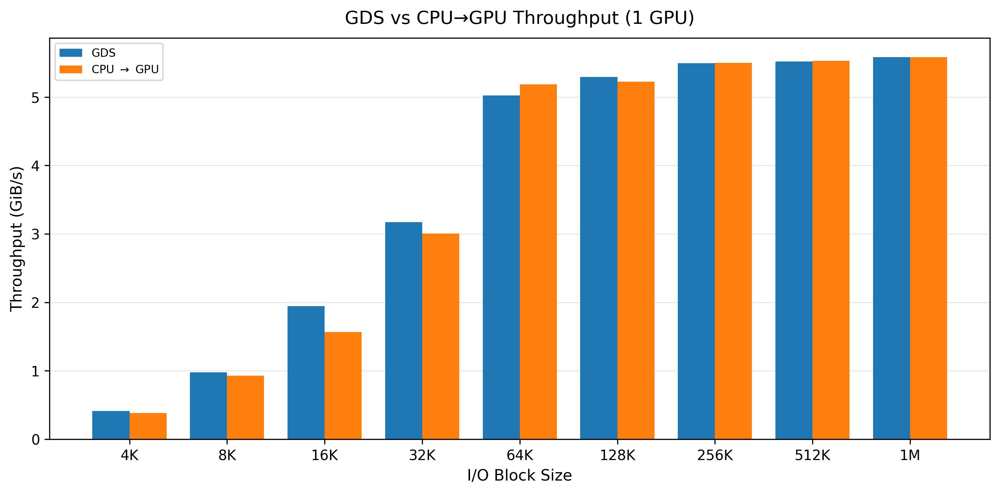
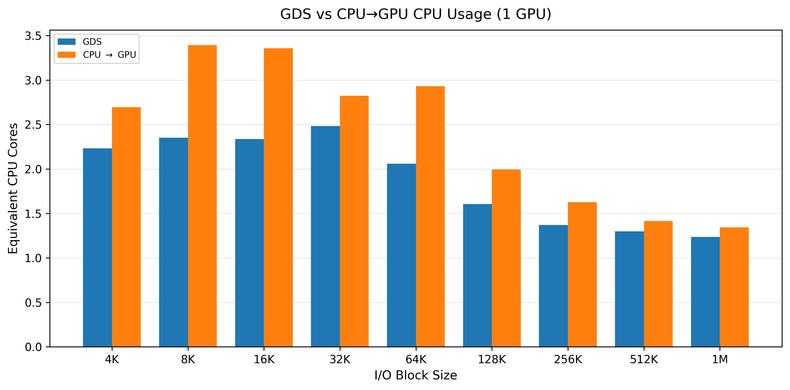
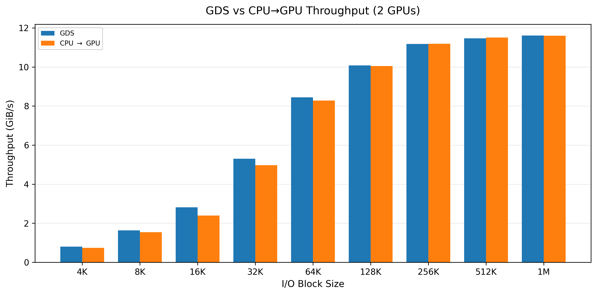
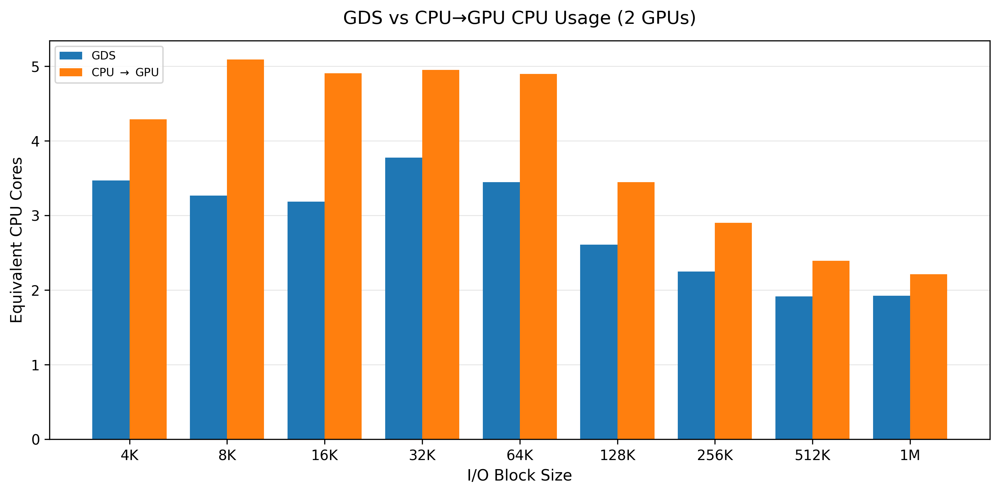
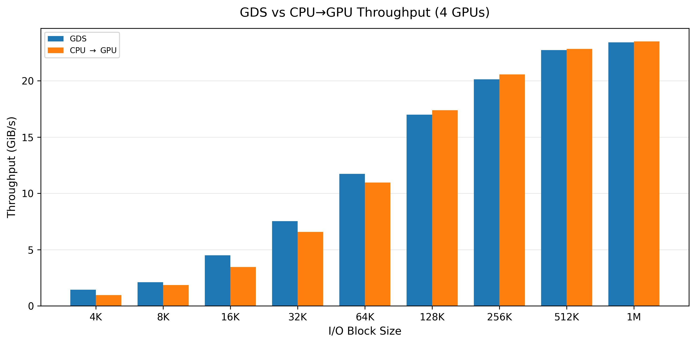
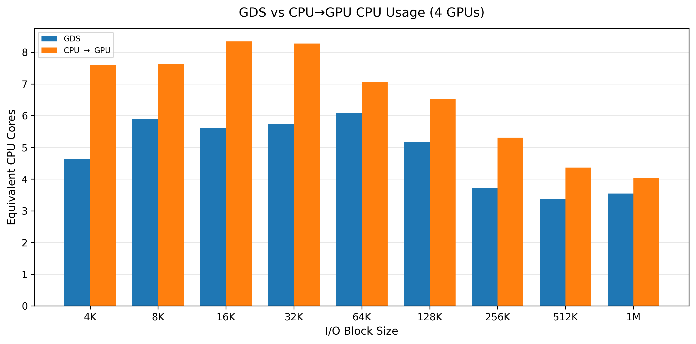
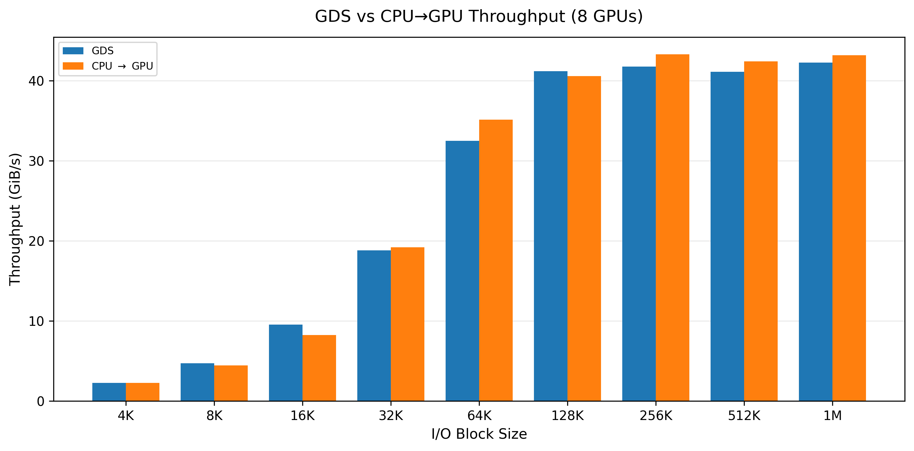
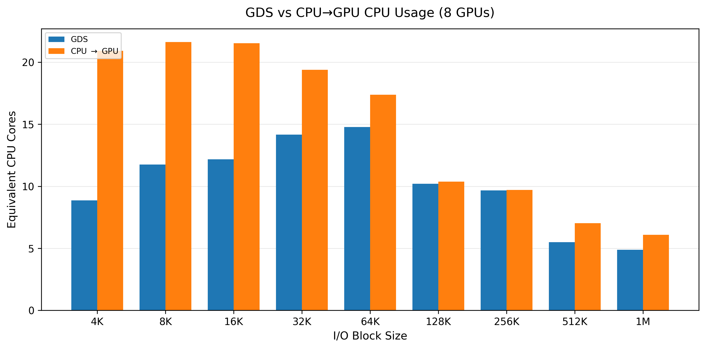

# GDS vs. CPU → GPU: Throughput and CPU Usage

[Overview](../README.md) · [Results summary](results.md) · [Benchmark environment](environment.md)

The eight charts below compare GPUDirect Storage (GDS) with the CPU → GPU path for 1, 2, 4, and 8 GPUs. The supplied image filenames identify these as remote runs. Each GPU configuration includes a throughput chart in **GiB/s** and a CPU usage chart in **equivalent CPU cores**, across I/O block sizes labeled 4K through 1M.

These charts supplement the [hardware baseline](results.md) with a separate storage transfer comparison. Their throughput values are not the [PCIe memory-copy measurements](pcie.md), which use **GB/s**. The images do not specify the remote storage configuration, benchmark commands, or run parameters; observations below are based on the plotted bars, with approximate values rather than raw measurements.

## One GPU

*Throughput rises with block size and converges at approximately 5.6 GiB/s for both paths at 1M. GDS has a visible advantage at 16K, while the CPU → GPU path is slightly faster at 64K.*

*GDS uses fewer equivalent CPU cores at every plotted block size. At 1M, usage is approximately 1.2 cores for GDS and 1.3 cores for CPU → GPU.*

## Two GPUs

*Both paths reach approximately 11.6 GiB/s at 1M. GDS is faster at smaller block sizes, with the throughput gap narrowing from 128K onward.*

*GDS consistently uses fewer equivalent CPU cores. At 1M, usage is approximately 1.9 cores for GDS and 2.2 cores for CPU → GPU.*

## Four GPUs

*Both paths reach approximately 23.4 GiB/s at 1M. GDS leads at 4K–64K, while CPU → GPU is slightly faster at 128K–1M.*

*GDS uses fewer equivalent CPU cores throughout the sweep. At 1M, usage is approximately 3.5 cores for GDS and 4.0 cores for CPU → GPU. The gap is larger at small block sizes.*

## Eight GPUs

*Throughput reaches roughly 41–43 GiB/s from 128K onward. At 1M, GDS delivers approximately 42.3 GiB/s and CPU → GPU approximately 43.2 GiB/s. Neither path leads at every block size.*

*The largest CPU usage gap appears at small blocks: at 4K, GDS uses approximately 8.9 equivalent cores versus 20.9 for CPU → GPU. Usage is close at 128K–256K. At 1M, GDS uses approximately 4.9 cores versus 6.1 for CPU → GPU.*

## Observations Across GPU Counts

- **Throughput increases with GPU count:** at 1M, both paths rise from approximately 5.6 GiB/s with one GPU to 11.6 GiB/s with two and 23.4 GiB/s with four. The eight-GPU results reach approximately 42–43 GiB/s, below a linear doubling of the four-GPU result.
- **Block size matters:** throughput generally rises with larger blocks before leveling off. CPU usage generally declines toward the largest blocks after peaking at smaller or intermediate sizes.
- **GDS reduces CPU usage in these charts:** the reduction is especially visible for small blocks with eight GPUs. At large blocks, throughput is similar between the paths, so CPU usage remains a useful part of the comparison.
- **The charts do not establish the limiting resource:** identifying a storage, network, or host bottleneck would require the run configuration and additional measurements.
