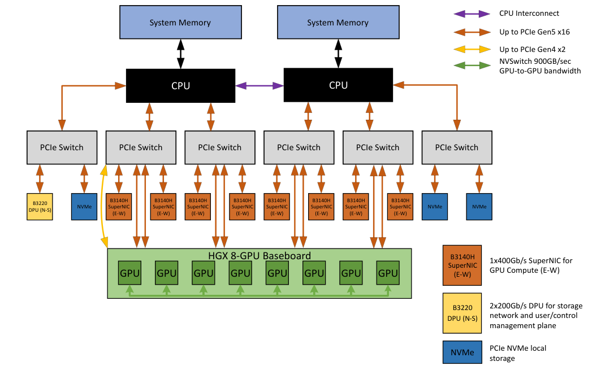
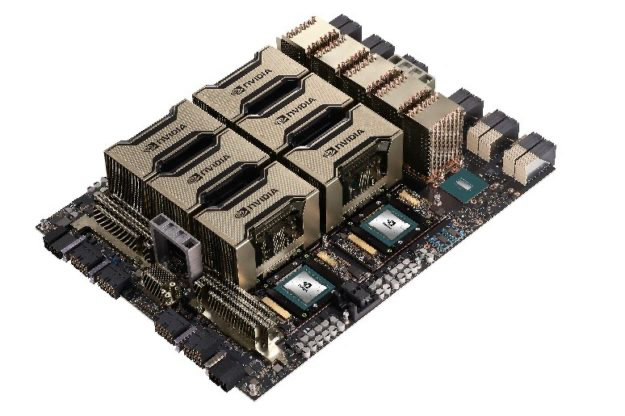

# Internal Topology of the HGX H200 System

[Overview](../README.md) · [Results summary](results.md) · [Benchmark environment](environment.md)

## NVIDIA Reference Architecture



*NVIDIA’s example HGX H100/H200/B200 8-GPU system architecture. PCIe connects the CPUs, GPUs, network adapters, and storage; the GPU baseboard provides the NVLink/NVSwitch interconnect. Source: [NVIDIA HGX AI Factory — Components, Figure 3](https://docs.nvidia.com/enterprise-reference-architectures/hgx-ai-factory-h100-h200-b200/latest/components.html).*

This is a reference design. It shows BlueField-3 SuperNICs and a DPU; the benchmark node uses the ConnectX-7 adapters and GPU-local NVMe layout documented in the [GPU–NIC–NVMe–NUMA mapping](#mapping-gpu--nic--nvme--numa) below. Use that mapping for the measured node’s devices.



*Physical view of the HGX H100/H200 8-GPU baseboard. Source: [NVIDIA HGX AI Factory — Components, Figure 1](https://docs.nvidia.com/enterprise-reference-architectures/hgx-ai-factory-h100-h200-b200/latest/components.html). Images are stored locally; original download links are recorded in [the image source notes](../assets/architecture/SOURCES.md).*

## Main Components

The current system consists of:

- **8 × NVIDIA H200 SXM 141 GB**.
- **2 × Intel Xeon Platinum 8558**, with 192 logical CPUs in total.
- **4 NUMA nodes**.
- **4 × third-generation NVSwitches** on the HGX H200 baseboard.
- Each H200 has **18 × fourth-generation NVLinks**.
- Each NVLink provides **50 GB/s of bidirectional bandwidth**, giving each GPU a total NVLink bandwidth of:

  ```text
  18 × 50 GB/s = 900 GB/s bidirectional
  ```

- For 8 GPUs, NVIDIA specifies **7.2 TB/s** of aggregate NVLink bandwidth for the HGX H100/H200 8-GPU baseboard.
- Each GPU also has a local PCIe branch containing:
  - 1 × H200 GPU;
  - 1 × NVIDIA/Mellanox ConnectX-7;
  - 1 × local Samsung NVMe drive.
- The 8 GPU-local 3.5 TB NVMe drives are currently combined into a RAID5 array at `/dev/md1`.
- Two ~894 GB NVMe drives (`nvme5n1`, `nvme6n1`) serve the operating system through RAID1 and are separate from the GPU-local NVMe group.

NVLink/NVSwitch topology sources:

- NVIDIA Fabric Manager User Guide: https://docs.nvidia.com/hgx-platforms/fabric-manager-user-guide/index.html
- NVIDIA NVLink specification: https://www.nvidia.com/en-us/data-center/nvlink/
- NVIDIA HGX H100/H200 reference architecture: https://docs.nvidia.com/enterprise-reference-architectures/hgx-ai-factory-h100-h200-b200/latest/components.html

Commands used to inspect the topology on the node:

```bash
nvidia-smi topo -m
lspci -tv
numactl --hardware
lsblk -o NAME,MODEL,SIZE,TYPE,MOUNTPOINT
```

## How Each GPU’s 18 NVLinks Connect to 4 NVSwitches

HGX H200 uses the same NVLink/NVSwitch topology as HGX H100. GPUs are not connected pairwise through dedicated cable groups; **each GPU connects to all 4 NVSwitches**, which route traffic between GPUs.

Each GPU distributes its 18 NVLinks as follows:

```text
                    H200 GPU
                       |
          +------------+------------+------------+
          |            |            |            |
       4 links      5 links      5 links      4 links
          |            |            |            |
      NVSwitch 1   NVSwitch 2   NVSwitch 3   NVSwitch 4

                     Total = 18 NVLinks/GPU
```

For 8 GPUs:

```text
8 GPU × 18 NVLinks/GPU = 144 GPU↔NVSwitch links
```

According to NVIDIA’s official topology:

- NVSwitch 1 receives 4 links from each GPU → **32 GPU-facing links**.
- NVSwitch 2 receives 5 links from each GPU → **40 GPU-facing links**.
- NVSwitch 3 receives 5 links from each GPU → **40 GPU-facing links**.
- NVSwitch 4 receives 4 links from each GPU → **32 GPU-facing links**.

Total:

```text
32 + 40 + 40 + 32 = 144 GPU↔NVSwitch links
```

The logical path between two GPUs is:

```text
GPU A
  |
  | NVLink 4
  v
NVSwitch fabric
  |
  | NVLink 4
  v
GPU B
```

Because all GPUs connect to the NVSwitch fabric, the system provides **full all-to-all GPU connectivity**. On this node, `nvidia-smi topo -m` reports `NV18` between GPU pairs, consistent with each GPU having 18 active NVLinks in the NVSwitch fabric.

## Mapping GPU – NIC – NVMe – NUMA

| GPU | GPU PCIe BDF | Local ConnectX-7 | Local NVMe | Nearest NUMA node |
|---|---|---|---|---:|
| GPU0 | `18:00.0` | `19:00.0` | `nvme7n1` / `1a:00.0` | 0 |
| GPU1 | `3a:00.0` | `3b:00.0` | `nvme9n1` / `3c:00.0` | 0 |
| GPU2 | `4b:00.0` | `4c:00.0` | `nvme1n1` / `4d:00.0` | 1 |
| GPU3 | `5c:00.0` | `5d:00.0` | `nvme8n1` / `5e:00.0` | 1 |
| GPU4 | `9a:00.0` | `9b:00.0` | `nvme2n1` / `9c:00.0` | 2 |
| GPU5 | `ba:00.0` | `bb:00.0` | `nvme4n1` / `bc:00.0` | 2 |
| GPU6 | `ca:00.0` | `cb:00.0` | `nvme0n1` / `cc:00.0` | 3 |
| GPU7 | `da:00.0` | `db:00.0` | `nvme3n1` / `dc:00.0` | 3 |

Example of GPU0’s local PCIe branch:

```text
                       CPU / PCIe Root Complex
                                |
                           PCIe Switch
                    ____________|____________
                   /            |            \
                  /             |             \
          H200 GPU0        ConnectX-7        NVMe7
          18:00.0           19:00.0          1a:00.0
```

Two distinct internal fabrics must therefore be distinguished:

```text
GPU ↔ GPU        : NVLink 4 / NVSwitch
GPU ↔ NIC/NVMe   : PCIe Gen5 local branch
GPU ↔ Host RAM   : PCIe Gen5 + CPU/NUMA memory path
```
